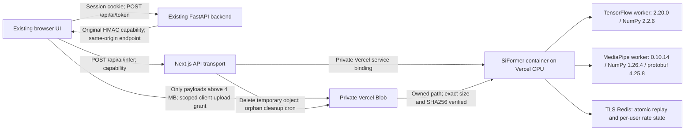

# SignHearing Vercel CPU migration — local implementation, release blocked

Date: 16 November 2026 (Asia/Bangkok). Repository: Thasi16/test_.
Branch: `deploy/vercel-siformer-cpu`; base: `f1944649d42f1303f754d2cecf9d21f0fb75b002`.

**The migration is not complete. No Preview or Production deployment was made.**
The native Linux container runs the original model on real inputs, but fails the
required Windows-to-Linux preprocessing/prediction parity gate. Production,
Supabase schemas, OAuth, and the user's original working tree were not changed.

## Candidate architecture implemented

The AI service has no public rewrite. Both workers communicate through the
original subprocess/stdin/NPZ protocol. Public transport routes expose neither
worker endpoints nor checkpoint files. All existing general rewrites remain in
place, with two specific AI transport exceptions preceding `/api/*`.

## What is preserved

`Siformer/project/vsl_tf/model.py::SiformerVSL`, `best.json`, epoch 47 binaries,
labels, architecture, checkpoint restores, original integrity checks, seed 396,
`training=False`, and the 100-class/27-curriculum mapping remain unchanged.
`app/preprocessing.py`, `landmark_worker.py`, `model_worker.py`, and every
landmark pipeline source/recipe are unchanged. The practice JavaScript edit is
confined to the network call after the original 30 JPEG frames are captured.
No CSS, JSX layouts, visual components, translations, camera capture parameters,
countdown, crop, frame order, or mirroring logic was changed.

The observed Windows TensorFlow environment currently has NumPy **1.26.4**,
despite its requirements declaring 2.2.6. The target keeps the requested 2.2.6.
A control using identical Windows landmarks produced bit-identical normalized
inputs on Linux and at most 3.8146973e-6 absolute logit difference. This separates
TensorFlow/platform rounding from the much larger MediaPipe differences.

## Dependency isolation and private assets

`ai_service/Dockerfile` uses a digest-pinned Python 3.12 Linux base and separate
`/opt/tf` and `/opt/mp` environments. Complete tested transitive versions are
recorded in `requirements-tf.lock` and `requirements-mp.lock`. CPU placement is
forced; the original model loader also verifies actual CPU execution.

`python -B -m ai_inference.deploy.package_service --model-root <original-export>`
checks the original training receipt, then an additional committed source
receipt covering normalization/vendor sources. It creates an allowlisted private
build context containing the checkpoint, receipt-required sources, original
normalization package, inference application, and shared token verifier. Generated
`ai_service/model` and `ai_service/src` are ignored by Git. They must be included
in the private CLI deployment context; a Git-only deployment without staging
these private files is intentionally not a complete build source.

No signing key, Supabase/OAuth credential, local `.env`, private video, or unrelated
recognition checkpoint is copied into the image. MediaPipe graph and four detector
assets come from the pinned package and pass the original provenance hashes.
Windows absolute paths are not used by the packaged runtime.

## Measured parity evidence and exact blocker

Evidence is committed in `ai_inference/reports/vercel-*.json`; full arrays remain
in ignored `.runtime/parity/`. Six fixed inputs were used: the three source MP4s
and three diagnostic 30-JPEG payloads generated once from those videos. These
JPEG fixtures are not physical webcam recordings.

- All decoded pixels, frame counts, sampled RGB pixels, sampling indices, valid
  masks, and padding masks match exactly across Windows and Linux.
- MediaPipe version, source graph, derived graph, and all four model hashes match.
- Each platform repeats its own landmark arrays and detection masks exactly.
- Cross-platform MediaPipe output differs. In `an-frames`, all 21 points of one
  hand differ in detection presence at sampled slot 10. This is not rounding.
- MP4 top-1 labels still match: Ăn → Cảm ơn; Uống → Băn khoăn; Khóc → Áp dụng.
  No attempt was made to correct those wrong predictions.
- Khóc MP4 confidence changes from 0.7950112224 to 0.8081129789: an absolute
  difference of 0.0131017566, or 1.3102 percentage points.
- The release gate requires exact discrete data, absolute landmark/input tolerance
  1e-5, logit tolerance 5e-6, and confidence tolerance 1e-6. The last two are based
  on the identical-landmark TensorFlow control. **Five of six full-pipeline
  samples fail.** Tolerances were not widened to conceal detector differences.

The difference is isolated to execution of the platform-specific MediaPipe worker;
the precise native-kernel/instruction cause has not been proven. Option B (split
Python services) would still execute the same Linux detector and does not remove
this measured blocker. A local alternative using the original Windows Python
3.12.3/MediaPipe binaries under Wine was also tried; NumPy's native extension
failed to load with a memory-access DLL error, including a bounded BLAS-target
probe. That experiment is not presented as a viable Vercel architecture.
No supported alternative with proven original behavior was established.

## Local build, security, and regression results

- Original and targeted AI suites: **24 passed**, including real Redis concurrency,
  cross-instance replay, cooldown, upload ownership/limits, exact byte restoration,
  redirect rejection, and fail-closed shared-state behavior.
- Backend: **121 passed, 1 skipped**; the skip requires a test PostgreSQL database.
- Existing frontend unit/deployment suites: **12 passed**; transport security:
  **4 passed**. Next.js production build and frontend lint pass.
- Practice rendering: **7 passed**.
- Existing browser regression: passed Vietnamese/mobile and English/desktop,
  countdown, exactly 30 JPEG frames, mirroring, cancellation, and unsupported signs.
  Its inference response is mocked and is not model verification.
- Six actual Linux API requests returned real CPU predictions. Cross-replica reuse
  of the same token returned 401. API result field names match the Windows baseline.
- Local cold start, read-only filesystem, warm requests, original model integrity,
  wrong/expired capabilities, rejection paths, worker timeout, and temporary-file
  cleanup were exercised through the appropriate real-runtime or plumbing tests.

The real local camera-to-Node-to-Linux-model-to-result flow passed both VI/mobile
and EN/desktop with exactly 30 frames through the new transport. Evidence is in
`vercel-browser-real-transport.json`. This uses loopback fixture authentication
and synthetic camera input; it cannot establish live Supabase, Google OAuth,
or a production authenticated session.

## Local resource measurements, not Vercel measurements

The final minimal locked runtime was restricted to **2 GiB RAM / 1 CPU**, with a
read-only root and a 384 MiB writable temporary mount. Fresh container start to
`/ready` was **9136.91 ms**. The six real warm API
requests took **981.28–1523.73 ms** inside the API. Peak cgroup memory
reached **2,147,483,648 bytes (2.000 GiB), the configured ceiling**.
All six requests returned 200; cgroup OOM and OOM-kill counters remained zero.
The final API schemas match Windows and confidences match the Linux trace within
1e-6. This does **not** prove safe memory headroom
on a 2 GB Vercel Function. A higher-memory plan/configuration must be measured on
Vercel before release; no upgrade or plan change was made. An earlier local image
measured 6.04 seconds cold start and 1.566 GiB peak, showing why one favorable
measurement must not be treated as a production guarantee.

The final image is reported by Docker at **1,219,079,564 bytes**;
`/opt/tf`, `/opt/mp`, application/model, and `/usr` occupy approximately **3.59 GB
extracted**. The final private staging context is **29,256,943 bytes / 55 files**;
the binary data shard is 28,983,479 bytes. The image ID is recorded in the package
and resource JSON files. No Vercel deployment bundle, registry optimization,
production peak RAM, or production latency was measured.

## Platform limits checked against current official documentation

Vercel currently supports container Functions and private service bindings. A
container must listen on port 80 or `PORT`, scales to zero, and must tolerate
cold starts and ephemeral state. This implementation opens one HTTP server and
retains both workers only for warm-instance reuse. See [Container Runtime](https://vercel.com/docs/functions/runtimes/container)
and [Services bindings](https://vercel.com/kb/guide/vercel-services).

Current documented Function limits include 4.5 MB request/response bodies,
2 GB/1 CPU on Hobby and up to 4 GB/2 CPU on Pro/Enterprise; Fluid execution defaults
to 300 seconds, with plan-specific higher limits. Standard Python bundles are
500 MB and Large Functions beta allows 5 GB for supported runtimes. Existing
projects can opt in with `VERCEL_SUPPORT_LARGE_FUNCTIONS=1`; this project's actual
Fluid/beta enrollment and container eligibility have not been checked because
Vercel is logged out. Memory is configured in project settings, not assumed from
image size. See [Function limits](https://vercel.com/docs/functions/limitations).

Registry limits are independently 2 GB per compressed layer, 15 GB total compressed
image, and 2,000,000 entries for optimization. Passing those does not prove Function
runtime viability. See [Registry limits](https://vercel.com/docs/container-registry/limits-and-pricing).

Subprocesses were verified locally inside the OCI image. The normal Function
filesystem is read-only except for temporary scratch space; no persistent local
files are assumed. See [Runtimes](https://vercel.com/docs/functions/runtimes).

## Payload transport, privacy, and remaining storage validation

Measured 30-JPEG fixtures are 1,245,908–1,253,408 bytes; the three videos are
845,139–1,000,430 bytes. Supported API uploads remain capped at 20 MiB, which exceeds
the platform limit. Small payloads travel unchanged through the same-origin proxy.
Payloads over 4,000,000 bytes use direct **private** Blob uploads, without decoding,
recompression, or frame changes. The original bytes are downloaded only from the
fixed configured private store, under `inference/<signed-jti>/payload`, with exact
size and SHA256 verification. Arbitrary URLs and redirects are rejected.

The short-lived client upload grant is independently single-use and rate-limited
in shared Redis. Inference consumes the original capability once across replicas.
The Node proxy deletes the private temporary object after inference; the browser
also requests cleanup. A secret-protected five-minute Cron removes orphaned
objects older than three minutes. Cleanup outages must be monitored; permanent
retention is not intended or accepted.

**Private Blob upload, cloud deletion, and orphan cleanup have not been exercised
against a connected store.** The five-minute schedule requires a supporting paid
plan; Hobby permits daily scheduling only. Cron is production-scoped, so Preview
orphan cleanup must be explicitly tested/operated before accepting Preview data
handling. Do not weaken cleanup or silently keep user videos to fit a plan.
See [Private Blob](https://vercel.com/docs/vercel-blob/private-storage),
[client uploads](https://vercel.com/docs/vercel-blob/client-upload), and
[Cron limits](https://vercel.com/docs/cron-jobs/usage-and-pricing).

## Required server-side environment variables

- `SIFORMER_SERVICE_URL`: generated binding on frontend/backend; never return it.
- `AI_TOKEN_SECRET`: reuse the existing signing secret on backend, transport, AI.
- `AI_STATE_BACKEND=redis`, `AI_REDIS_URL` (TLS), and `AI_STATE_NAMESPACE`: AI only.
  Provision consistent shared state with appropriate durability and no eviction;
  use distinct namespaces for isolated Preview and Production tests.
- `AI_ALLOWED_ORIGINS`: exact allowed website origins. Trusted system deployment
  URLs are added on Vercel; no wildcard browser origins are accepted.
- `AI_BLOB_ORIGIN`: fixed private store origin on backend, transport, and AI.
- `BLOB_READ_WRITE_TOKEN`: private store credential on transport and AI only.
- `CRON_SECRET`: separate cleanup secret on the frontend service.
- `VERCEL_SUPPORT_LARGE_FUNCTIONS=1`: investigate/enable for Preview where required
  by the account; this flag is not proof of container runtime approval.
- Existing `SITE_URL`, Supabase and OAuth configuration: retained.
- `AI_DEVICE=cpu`, `MP_PYTHON`, `CUDA_VISIBLE_DEVICES=-1`: set by the image.

No new secret belongs in `NEXT_PUBLIC_*`. `AI_API_URL` is not used by the Vercel
path when the binding exists; legacy local operation still supports its old URL.

## Deployment status and next release gate

Vercel CLI **65.16.0** reports **logged out**. No linked `.vercel/project.json`,
Vercel plan/feature state, TLS Redis credential, private Blob credential, or live
user session was available for this migration checkout. No cloud resources,
environment variables, GitHub refs, or deployed aliases were changed.

Preview URL: **none**. Migration Production URL: **none**. The existing application
URL supplied by the user is https://test-signhearing.vercel.app; it was not promoted
or claimed as a verified migration. A laptop-off authenticated production test,
Google OAuth login/logout, Supabase learning data, large cloud uploads, and actual
Vercel cold starts remain unverified.

`ai_inference/deploy/preview.ps1` reruns the parity gate before packaging/deploying,
requires the existing project to be linked, and creates Preview only. It currently
stops on the measured parity failure. First resolve native detector equivalence
without changing the required pipeline, then validate the account/resources and
Preview with real authentication, private storage cleanup, and the tunnel disabled.
Production promotion remains prohibited until all requested acceptance checks pass.

## Files and rollback

The complete path inventory is in `vercel-changed-files.json`. It includes container
packaging/locks, replay and Blob receivers, existing API configuration/token/CSP
integration, three Node transport routes, one browser transport helper, targeted
tests, and this report/evidence. No files were removed. No visual source was edited.
The local branch is isolated from all pre-existing teammate changes and has not
been pushed. Use `git log -1` in this checkout for the handoff commit.

No production rollback is necessary because nothing was deployed. Keep the current
working production deployment and its environment intact. For a later release,
record the previous deployment ID and AI environment values before changing them;
use Vercel's deployment rollback to that ID if needed, and restore only the changed
AI variables. Revert the migration commit normally for code rollback; do not reset
or force-push `main`. Stop/discard only the local test containers, not the verified
Windows inference API. The original export/checkpoint remains untouched.

## Final minimal-image verification

Image `sha256:596af822b827e4d6951c4e11c56ff4e622d4a4ce5028ec8577d03d1549aeae31`: Docker-reported size 1,219,079,564 bytes; staged package 29,256,943 bytes / 55 files. Fresh read-only 2 GiB/1 CPU container start to ready: 9136.91 ms; peak cgroup RAM after all six real requests: 2,147,483,648 bytes (2.000 GiB). All six actual requests returned 200. See the final resource and API JSON snapshots; the earlier measurements above are retained for comparison. These remain local measurements.
